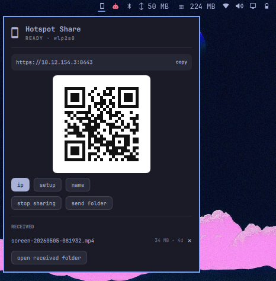

# Hotspot Share for Omarchy

A native Omarchy bar widget that shares files between your laptop and your
phone over the phone's hotspot. No browser or web app is used on the laptop:
the widget shows the QR code, connected devices, incoming offers, and both
file folders.

The phone still uses the web app the local server serves, and can install it
as a PWA.



## Install

```sh
omarchy plugin add https://github.com/Joweb1/omarchy-hotspot-share.git --enable
```

The plugin runs from `~/.config/omarchy/plugins/jovibe.hotspot-share/` and owns
its server process. Nothing is copied to `~/.local/bin`, no systemd unit is
installed, and the installer never runs privileged commands.

Validate a checkout before publishing:

```sh
omarchy plugin validate ./omarchy-hotspot-share
```

## Usage

1. Connect the laptop to the phone's hotspot.
2. Click the phone icon in the bar. Sharing starts automatically.
3. On the phone, open the `setup` URL once to install the local certificate,
   then use the `ip` URL (or scan the `ip` QR code).
4. Send files from the laptop with **send folder**, or from the phone through
   the web app. Incoming offers appear in the widget.

The widget starts the server when a LAN/hotspot address appears and stops it
15 seconds after the network goes away. **stop sharing** pauses it until you
start it again.

## Firewall

`omarchy plugin add` deliberately never uses sudo, so the firewall is the only
manual step. If the phone cannot connect, click **fix firewall** in the widget
(one polkit prompt), or run:

```sh
~/.config/omarchy/plugins/jovibe.hotspot-share/hs firewall
```

That allows TCP 8080/8443 and UDP 5353 from private networks only. Rules are
persisted by UFW and survive reboots.

## Dependencies

Install with your package manager if missing:

- `node` (18 or newer)
- `openssl` (certificate authority for HTTPS)
- `qrencode` (QR code rendering)
- `avahi` (`avahi-publish`, optional mDNS name)
- `libnotify` (`notify-send`, optional notifications)
- `wl-clipboard` (`wl-copy`, copy URL button)
- `xdg-utils` (`xdg-open`, open folders)

The phone needs a modern browser. Installing the generated CA enables the
HTTPS app; the plain HTTP setup page is always available on the local network.

## Configure

Show the icon even when no LAN is present:

```sh
omarchy bar set jovibe.hotspot-share alwaysShow true
```

Move it:

```sh
omarchy bar move jovibe.hotspot-share --section right
```

Files live in `~/Hotspot Share/send` and `~/Hotspot Share/received`. The
received list shows the six newest files; **×** only hides a file from the
list (it is never deleted). State, certificates, logs, and the dismissed list
live in `~/.local/share/hotspot-share/`.

## Remove

Stop sharing first, then remove the widget:

```sh
~/.config/omarchy/plugins/jovibe.hotspot-share/hs halt
omarchy plugin remove jovibe.hotspot-share
```

Optionally delete the shared folders and state:

```sh
rm -rf ~/"Hotspot Share" ~/.local/share/hotspot-share
```

## License

MIT. See [LICENSE](LICENSE).
